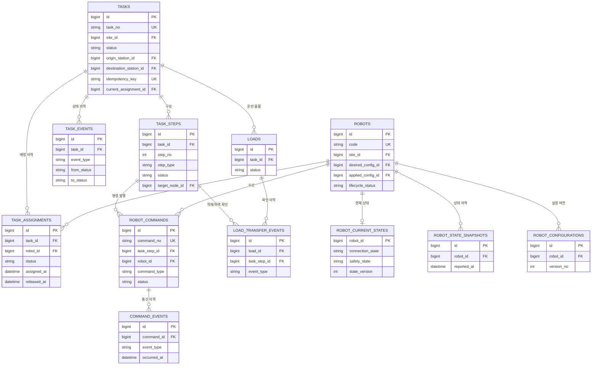
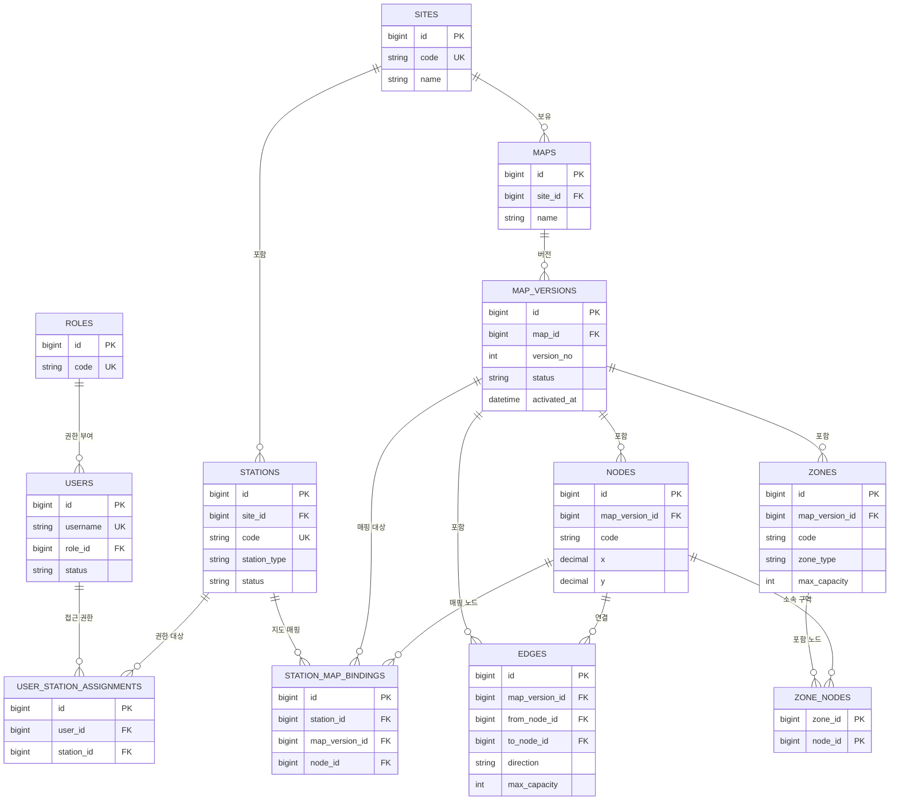

# ERD 초안 (v0)

`DESIGN.md` §6(상태 모델과 데이터베이스)을 기준으로 작성한 초안. 테이블 그룹핑은 DESIGN.md와 동일하게 유지했다.

## 설계 원칙

- **관리자 설정값과 로봇이 실제 보고한 값을 분리**한다. (`robot_configurations`의 요청/적용 버전, `robot_current_states` vs `robot_state_snapshots`)
- **작업(Task) / 단계(Step) / 명령(Command)을 분리**한다. 하나의 작업은 여러 단계로, 하나의 단계는 0~N개의 로봇 명령으로 이어진다.
- **멱등성·중복 방지 제약을 스키마 레벨에서 강제**한다. (`tasks.idempotency_key`, `robot_commands.command_no`, `inbox_messages.message_key` 등 UNIQUE 제약)
- **이력(events)과 현재 상태(current)를 분리**한다. 현재 상태는 빠른 조회용, 이벤트 테이블은 감사·재현·디버깅용 append-only 로그.
- 지도는 **버전 관리**된다(`map_versions`). 노드/통로/구역은 특정 버전에 속한다.
- 이 초안은 MySQL 기준이며, BIGINT AUTO_INCREMENT를 내부 PK로, 업무 식별자(예: `task_no`, `command_no`)는 별도 UNIQUE 컬럼으로 둔다.

DESIGN.md에 없던 테이블을 몇 개 추가했다 — 아래 "초안에서 임의로 보완한 부분"에 별도 표시했으니, 확정 전에 검토가 필요하다.

---

## 1. 핵심 운영 흐름 (로봇 / 작업 / 명령 / 배정)

---

## 2. 사용자 / 시설 / 지도

---

## 3. 자원 / 물품 / 이벤트 / 운영

```mermaid
erDiagram
    ROBOTS ||--o{ RESOURCE_RESERVATIONS : "예약"
    TASK_STEPS ||--o{ RESOURCE_RESERVATIONS : "연관 단계"
    ROBOTS ||--o{ CHARGING_SESSIONS : "충전"
    STATIONS ||--o{ CHARGING_SESSIONS : "충전 지점"
    TASKS ||--o{ CHARGING_SESSIONS : "자동 충전 작업"
    ALARMS ||--o{ ALARM_EVENTS : "이력"
    USERS ||--o{ AUDIT_LOGS : "조작"
    USERS ||--o{ ALARM_EVENTS : "확인/해제"

    RESOURCE_RESERVATIONS {
        bigint id PK
        string resource_type
        bigint resource_id
        bigint robot_id FK
        bigint task_step_id FK
        string status
        datetime expires_at
    }
    CHARGING_SESSIONS {
        bigint id PK
        bigint robot_id FK
        bigint station_id FK
        bigint task_id FK
        string status
    }
    OUTBOX_EVENTS {
        bigint id PK
        string aggregate_type
        bigint aggregate_id
        string event_type
        string status
    }
    INBOX_MESSAGES {
        bigint id PK
        string source
        string message_key UK
        string status
    }
    ALARMS {
        bigint id PK
        string alarm_type
        string severity
        string source_type
        bigint source_id
        string status
    }
    ALARM_EVENTS {
        bigint id PK
        bigint alarm_id FK
        string event_type
        bigint created_by FK
    }
    AUDIT_LOGS {
        bigint id PK
        bigint actor_user_id FK
        string action
        string target_type
        bigint target_id
    }
```

---

## 4. 테이블 상세

### 4.1 사용자 (users, roles, user_station_assignments)

**32단계 구현(V13)**: `users.password_changed_at DATETIME(6) NULL` — 마지막 비밀번호 변경 시각. 이보다 먼저 발급된 접근 토큰은 무효다(API.md §1). 바꾼 적 없으면 NULL.

**roles**
| 컬럼 | 타입 | 설명 |
|---|---|---|
| id | BIGINT PK | |
| code | VARCHAR UK | `ADMIN`, `WORKER` 등 |
| name | VARCHAR | |

**users**
| 컬럼 | 타입 | 설명 |
|---|---|---|
| id | BIGINT PK | |
| username | VARCHAR UK | |
| password_hash | VARCHAR | |
| display_name | VARCHAR | |
| role_id | BIGINT FK → roles | |
| status | VARCHAR | `ACTIVE`, `DISABLED` |
| created_at / updated_at | DATETIME | |

**user_station_assignments**
| 컬럼 | 타입 | 설명 |
|---|---|---|
| id | BIGINT PK | |
| user_id | BIGINT FK → users | |
| station_id | BIGINT FK → stations | |
| created_at | DATETIME | |
| | | UNIQUE(user_id, station_id) |

### 4.2 시설 (sites, stations)

**sites**
| 컬럼 | 타입 | 설명 |
|---|---|---|
| id | BIGINT PK | |
| code | VARCHAR UK | |
| name | VARCHAR | |
| status | VARCHAR | |

**stations**
| 컬럼 | 타입 | 설명 |
|---|---|---|
| id | BIGINT PK | |
| site_id | BIGINT FK → sites | |
| code | VARCHAR | site 내 UNIQUE |
| name | VARCHAR | |
| station_type | VARCHAR | `PICKUP`, `DROPOFF`, `WAITING`, `CHARGING`, `GENERIC` |
| status | VARCHAR | `ACTIVE`, `INACTIVE` |

### 4.3 지도 (maps, map_versions, nodes, edges, zones)

**maps**
| 컬럼 | 타입 | 설명 |
|---|---|---|
| id | BIGINT PK | |
| site_id | BIGINT FK → sites | |
| name | VARCHAR | |

**map_versions**
| 컬럼 | 타입 | 설명 |
|---|---|---|
| id | BIGINT PK | |
| map_id | BIGINT FK → maps | |
| version_no | INT | |
| file_path | VARCHAR | 지도 원본 파일 위치 |
| coordinate_system | VARCHAR | |
| status | VARCHAR | `DRAFT`, `VALIDATED`, `ACTIVE`, `ARCHIVED` |
| validated_at / activated_at | DATETIME | |
| created_by | BIGINT FK → users | |
| | | UNIQUE(map_id, version_no) |

**nodes**
| 컬럼 | 타입 | 설명 |
|---|---|---|
| id | BIGINT PK | |
| map_version_id | BIGINT FK → map_versions | |
| code | VARCHAR | |
| x, y | DECIMAL | |
| node_type | VARCHAR | `WAYPOINT`, `STATION`, `CHARGING` |

**edges**
| 컬럼 | 타입 | 설명 |
|---|---|---|
| id | BIGINT PK | |
| map_version_id | BIGINT FK → map_versions | |
| from_node_id / to_node_id | BIGINT FK → nodes | |
| direction | VARCHAR | `ONE_WAY`, `TWO_WAY` |
| distance | DECIMAL | |
| max_capacity | INT | 동시 진입 허용 로봇 수 |

**zones**
| 컬럼 | 타입 | 설명 |
|---|---|---|
| id | BIGINT PK | |
| map_version_id | BIGINT FK → map_versions | |
| code | VARCHAR | |
| zone_type | VARCHAR | `MUTEX_ZONE`, `SAFETY_ZONE` 등 |
| max_capacity | INT | |

**zone_nodes** (추가 제안 테이블, §5 참고)
| 컬럼 | 타입 | 설명 |
|---|---|---|
| zone_id | BIGINT PK, FK → zones | |
| node_id | BIGINT PK, FK → nodes | |
| | | 복합 PK(zone_id, node_id) |

**station_map_bindings** (추가 제안 테이블, §5 참고)
| 컬럼 | 타입 | 설명 |
|---|---|---|
| id | BIGINT PK | |
| station_id | BIGINT FK → stations | |
| map_version_id | BIGINT FK → map_versions | |
| node_id | BIGINT FK → nodes | |
| | | UNIQUE(station_id, map_version_id) |

### 4.4 로봇 (robots, robot_configurations, robot_state_snapshots)

**robots**
| 컬럼 | 타입 | 설명 |
|---|---|---|
| id | BIGINT PK | |
| code | VARCHAR UK | 로봇 고유 식별자 |
| name | VARCHAR | |
| model / manufacturer | VARCHAR | |
| site_id | BIGINT FK → sites | |
| desired_config_id | BIGINT FK → robot_configurations | 요청된 설정 |
| applied_config_id | BIGINT FK → robot_configurations | 실제 적용된 설정 |
| lifecycle_status | VARCHAR | `REGISTERED`, `IN_SERVICE`, `MAINTENANCE`, `DECOMMISSIONED` |

> **설계 가정**: `lifecycle_status`(관리자가 설정하는 운영 대상 여부)와 로봇이 실시간 보고하는 `robot_current_states.operation_mode`(`AUTO`/`MANUAL`/`MAINTENANCE`, STATE_MACHINES.md §4.2)는 이름은 비슷하지만 서로 다른 축이며 자동 동기화되지 않는다. 배정기는 **둘 다** 확인한다 — `lifecycle_status = IN_SERVICE` **AND** `operation_mode = AUTO`가 아니면 배정 대상에서 제외한다. 관리자가 `lifecycle_status`를 `MAINTENANCE`로 바꿔도 로봇이 여전히 `AUTO`를 보고하는 불일치는 정상적인 과도 상태로 간주하고, 배정만 막는다(강제로 값을 맞추지 않는다). 이 판단은 확정된 요구사항이 아니라 초안 작성 중 내린 가정이므로 검토 필요.

**robot_configurations**
| 컬럼 | 타입 | 설명 |
|---|---|---|
| id | BIGINT PK | |
| robot_id | BIGINT FK → robots | |
| version_no | INT | |
| max_payload_kg / max_speed_mps | DECIMAL | |
| battery_capacity_wh | DECIMAL | |
| charging_low_threshold_pct / charging_target_pct | INT | |
| config_json | JSON | 장비별 세부 설정 |
| created_by | BIGINT FK → users | |
| | | UNIQUE(robot_id, version_no) |

**robot_state_snapshots** (이력, append-only)
| 컬럼 | 타입 | 설명 |
|---|---|---|
| id | BIGINT PK | |
| robot_id | BIGINT FK → robots | |
| connection_state | VARCHAR | `ONLINE`, `STALE`, `OFFLINE` |
| operation_mode | VARCHAR | `AUTO`, `MANUAL`, `MAINTENANCE` |
| motion_state | VARCHAR | `IDLE`, `MOVING`, `DOCKING`, `CHARGING` |
| safety_state | VARCHAR | `NORMAL`, `PROTECTIVE_STOP`, `EMERGENCY_STOP` |
| load_state | VARCHAR | `EMPTY`, `LOADED`, `UNKNOWN` |
| localization_state | VARCHAR | `LOCALIZED`, `LOST`, `UNKNOWN` |
| battery_pct | INT | |
| current_node_id | BIGINT FK → nodes | nullable. **30단계 구현(V11)**: `robot_current_states`와 이 이력 테이블 둘 다에 추가했다. 시뮬레이터는 이동 명령이 성공하면 목적지 작업장이 연결된 활성 지도 노드로 채우고, 지도·바인딩이 없으면 null로 둔다. 엔티티에서는 `robot_id`와 같은 이유로 연관관계 없이 스칼라(`Long`)로 매핑한다 |
| pose_x / pose_y / pose_heading | DECIMAL | **미구현** — 노드 사이 좌표는 DB에 남기지 않고 화면 표시용 `robot.position` 이벤트로만 흘려보낸다(API.md §5) |
| reported_at | DATETIME | 로봇이 보고한 시각 |
| received_at | DATETIME | 서버 수신 시각. 29단계부터 하트비트 기반 연결 감시가 이 값을 본다(STATE_MACHINES.md §4.1) |

### 4.5 작업 (tasks, task_steps, task_assignments, task_events)

**tasks**
| 컬럼 | 타입 | 설명 |
|---|---|---|
| id | BIGINT PK | |
| task_no | VARCHAR UK | 업무 식별자 |
| site_id | BIGINT FK → sites | |
| task_type | VARCHAR | `TRANSPORT`, `CHARGE`(자동 충전 작업) |
| priority | INT | |
| status | VARCHAR | `QUEUED`, `ASSIGNED`, `RUNNING`, `PAUSED`, `CANCEL_REQUESTED`, `CANCELED`, `RECOVERY_REQUIRED`, `SUCCEEDED`, `FAILED` |
| origin_station_id / destination_station_id | BIGINT FK → stations | |
| requested_by | BIGINT FK → users | nullable |
| idempotency_key | VARCHAR UK | 중복 호출 방지 |
| external_ref | VARCHAR | WMS 등 외부 연동 참조 |
| current_assignment_id | BIGINT FK → task_assignments | nullable, 현재 활성 배정 |
| created_at / updated_at / completed_at | DATETIME | |

**task_steps**
| 컬럼 | 타입 | 설명 |
|---|---|---|
| id | BIGINT PK | |
| task_id | BIGINT FK → tasks | |
| step_no | INT | |
| step_type | VARCHAR | 운반 작업: `MOVE_TO_ORIGIN`, `CONFIRM_LOAD`, `MOVE_TO_DESTINATION`, `CONFIRM_UNLOAD`. 자동 충전 작업(`task_type = CHARGE`): `MOVE_TO_CHARGING_STATION`, `DOCK_AND_CHARGE` |
| status | VARCHAR | `PENDING`, `RUNNING`, `SUCCEEDED`, `FAILED`, `SKIPPED` |
| target_node_id | BIGINT FK → nodes | nullable |
| started_at / completed_at | DATETIME | |
| | | UNIQUE(task_id, step_no) |

**task_assignments**
| 컬럼 | 타입 | 설명 |
|---|---|---|
| id | BIGINT PK | |
| task_id | BIGINT FK → tasks | |
| robot_id | BIGINT FK → robots | |
| status | VARCHAR | `ACTIVE`, `RELEASED`, `COMPLETED` |
| assigned_at / released_at | DATETIME | |

**task_events** (이력)
| 컬럼 | 타입 | 설명 |
|---|---|---|
| id | BIGINT PK | |
| task_id | BIGINT FK → tasks | |
| event_type | VARCHAR | |
| from_status / to_status | VARCHAR | nullable |
| payload_json | JSON | |
| created_by | BIGINT FK → users | nullable |
| created_at | DATETIME | |

### 4.6 명령 (robot_commands, command_events)

**robot_commands**
| 컬럼 | 타입 | 설명 |
|---|---|---|
| id | BIGINT PK | |
| command_no | VARCHAR UK | 멱등성/추적 키 |
| task_step_id | BIGINT FK → task_steps | nullable (충전 명령 등은 단계 미연결 가능) |
| robot_id | BIGINT FK → robots | |
| command_type | VARCHAR | `MOVE_TO`, `DOCK`, `UNDOCK`, `START_CHARGE`, `STOP_CHARGE`, `CANCEL`, `EMERGENCY_STOP` |
| payload_json | JSON | |
| status | VARCHAR | `PENDING`, `SENT`, `ACCEPTED`, `RUNNING`, `SUCCEEDED`, `FAILED`, `UNKNOWN` |
| sent_at / accepted_at / completed_at | DATETIME | |

**command_events** (통신 이력)
| 컬럼 | 타입 | 설명 |
|---|---|---|
| id | BIGINT PK | |
| command_id | BIGINT FK → robot_commands | |
| event_type | VARCHAR | `SENT`, `ACCEPTED`, `PROGRESS`, `SUCCEEDED`, `FAILED`, `TIMEOUT`, `RECONNECTED` |
| payload_json | JSON | |
| occurred_at | DATETIME | 로봇/게이트웨이 보고 시각 |
| received_at | DATETIME | 서버 수신 시각 |

### 4.7 자원 (resource_reservations, charging_sessions)

**resource_reservations**
| 컬럼 | 타입 | 설명 |
|---|---|---|
| id | BIGINT PK | |
| resource_type | VARCHAR | `EDGE`, `ZONE`, `STATION`, `NODE`(46단계 — 교통 관리 경로 노드, resource_id = nodes.id. 47단계: task_step_id가 없으면 비키기 이동의 경로) |
| resource_id | BIGINT | resource_type에 따른 대상 ID (다형성, 앱 레벨 검증) |
| robot_id | BIGINT FK → robots | |
| task_step_id | BIGINT FK → task_steps | nullable |
| status | VARCHAR | `HELD`, `RELEASED`, `EXPIRED` |
| reserved_at / released_at / expires_at | DATETIME | |

**charging_sessions**
| 컬럼 | 타입 | 설명 |
|---|---|---|
| id | BIGINT PK | |
| robot_id | BIGINT FK → robots | |
| station_id | BIGINT FK → stations | |
| task_id | BIGINT FK → tasks | nullable |
| status | VARCHAR | `RESERVED`, `CHARGING`, `COMPLETED`, `ABORTED` |
| battery_start_pct / battery_end_pct | INT | |
| started_at / completed_at | DATETIME | |

### 4.8 물품 (loads, load_transfer_events) — **미구현**

`loads`/`load_transfer_events` 테이블은 마이그레이션·엔티티가 없다. `report-out-of-stock`(재고 없음) API가 8단계에서 "정책 미정"으로 보류된 것과 같은 이유로, 이 테이블들도 함께 보류 상태다(`docs/API.md` §4 참고). 현재 구현은 물품 단위 추적 없이 `task_steps`(`CONFIRM_LOAD`/`CONFIRM_UNLOAD`)만으로 적재·하역을 확인한다.

> **용어 구분**: `loads.status`(이 아래 표)와 로봇의 `load_state` 축(STATE_MACHINES.md §4.5, `EMPTY`/`LOADED`/`UNKNOWN`)은 서로 다른 개념이다. `loads.status`는 **업무 관점의 물품 상태**(주문/배송 단위 추적)이고, 로봇 `load_state`는 **로봇 적재 센서의 실시간 값**이다. 둘의 연결 규칙: 작업자가 "로봇 보내기"(적재 확인)를 누르면 `loads.status → LOADED`로 바뀌지만, 이는 로봇 센서값을 그대로 신뢰하는 것이 아니라 **작업자의 육안 확인**을 기록하는 것이다. 로봇 `load_state`가 `EMPTY`인데 `loads.status`가 `LOADED`인 불일치(예: 물품이 로봇에서 떨어짐)는 원래 별도 알람으로 처리할 계획이었으나, `loads` 자체가 미구현이라 이 **업무 상태 vs 센서 불일치** 알람은 여전히 없다. §4.10의 `LOAD_EXCEPTION` 알람(14단계 구현)은 이것과 다른, 더 좁은 범위다 — `loads` 없이 로봇 `load_state`가 센서 이상(`UNKNOWN`)을 보고할 때만 발생한다.

**loads**
| 컬럼 | 타입 | 설명 |
|---|---|---|
| id | BIGINT PK | |
| task_id | BIGINT FK → tasks | |
| load_code | VARCHAR | nullable, 바코드 등 |
| description | VARCHAR | |
| quantity | INT | |
| status | VARCHAR | `PENDING`, `LOADED`, `DELIVERED`, `EXCEPTION` |

**load_transfer_events**
| 컬럼 | 타입 | 설명 |
|---|---|---|
| id | BIGINT PK | |
| load_id | BIGINT FK → loads | |
| task_step_id | BIGINT FK → task_steps | |
| event_type | VARCHAR | `LOAD_CONFIRMED`, `UNLOAD_CONFIRMED`, `OUT_OF_STOCK`, `LOAD_FAILED` |
| confirmed_by | BIGINT FK → users | |
| note | VARCHAR | |

### 4.9 이벤트 (outbox_events, inbox_messages)

`outbox_events`는 구현되어 있다(`OutboxEvent` 엔티티, `OutboxEventStatus`: `PENDING`/`PUBLISHED`/`FAILED`). **`inbox_messages`는 미구현** — 외부/로봇 메시지 중복 제거는 이 별도 테이블 대신 리소스별 UNIQUE 제약(`tasks.idempotency_key` 등, `docs/API.md` 공통 규칙 참고)으로 처리한다.

**outbox_events**
| 컬럼 | 타입 | 설명 |
|---|---|---|
| id | BIGINT PK | |
| aggregate_type | VARCHAR | `TASK`, `COMMAND`, `ROBOT`, `ALARM` 등 |
| aggregate_id | BIGINT | |
| event_type | VARCHAR | |
| payload_json | JSON | |
| status | VARCHAR | `PENDING`, `PUBLISHED`, `FAILED` |
| created_at / published_at | DATETIME | |

**31단계 구현**: 인덱스 `(status, id)`(릴레이의 `FOR UPDATE SKIP LOCKED` 폴링), `(status, created_at)`(보관 정책 삭제). 발행 완료 후 `app.retention.days`(기본 30일)가 지난 행은 매일 삭제한다. PENDING은 지우지 않는다.

**inbox_messages**
| 컬럼 | 타입 | 설명 |
|---|---|---|
| id | BIGINT PK | |
| source | VARCHAR | `ROBOT_GATEWAY`, `WMS` 등 |
| message_key | VARCHAR UK | 중복 제거 키 |
| message_type | VARCHAR | |
| payload_json | JSON | |
| status | VARCHAR | `RECEIVED`, `PROCESSED`, `IGNORED`, `FAILED` |
| received_at / processed_at | DATETIME | |

### 4.10 운영 (alarms, alarm_events, audit_logs)

`alarms`/`alarm_events`는 14단계, `audit_logs`는 37단계에서 구현했다 (`docs/API.md` §3, `docs/STATE_MACHINES.md` §7 참고).

**alarms** (14단계 구현)
| 컬럼 | 타입 | 설명 |
|---|---|---|
| id | BIGINT PK | |
| alarm_type | VARCHAR | `ROBOT_COMM_LOST`, `LOCALIZATION_LOST`, `TASK_FAILED`, `LOAD_EXCEPTION`, `TASK_RECOVERY_REQUIRED`(27단계), `ROBOT_EMERGENCY_STOP`(33단계) |
| severity | VARCHAR | `INFO`, `WARNING`, `CRITICAL` — 14단계 구현은 `TASK_FAILED`=`CRITICAL`, 나머지=`WARNING`으로 고정 배정한다 |
| source_type | VARCHAR | `ROBOT`, `TASK`, `STATION`, `SYSTEM` — 14단계 구현은 `ROBOT`/`TASK`만 실제 사용 |
| source_id | BIGINT | |
| status | VARCHAR | `OPEN`, `ACKNOWLEDGED`, `RESOLVED` |
| message | VARCHAR | |
| acknowledged_at / acknowledged_by | DATETIME / BIGINT FK → users | |
| resolved_at / resolved_by | DATETIME / BIGINT FK → users | 자동 해소 시 `resolved_by`는 null(시스템) |
| created_at / updated_at | DATETIME | `BaseAuditableEntity` |

같은 (alarm_type, source_type, source_id) 조합의 `OPEN`/`ACKNOWLEDGED` 알람은 항상 최대 1개다 (`AlarmService`가 보장).

**alarm_events** (14단계 구현, task_events와 동일한 append-only 패턴)
| 컬럼 | 타입 | 설명 |
|---|---|---|
| id | BIGINT PK | |
| alarm_id | BIGINT FK → alarms | |
| event_type | VARCHAR | `RAISED`, `ACKNOWLEDGED`, `RESOLVED` — `REOPENED`는 아직 미사용(재발생 시 새 알람을 만들 뿐, 기존 alarms row를 재사용하지 않음) |
| note | VARCHAR | |
| created_by | BIGINT FK → users | nullable(시스템 자동 발생/해소는 null) |
| created_at | DATETIME | API로 노출하지 않는 내부 감사 로그 |

**audit_logs** (37단계 구현, V15, append-only)
| 컬럼 | 타입 | 설명 |
|---|---|---|
| id | BIGINT PK | |
| actor_user_id | BIGINT FK → users | nullable — 외부 시스템(API 키), 없는 아이디 로그인 실패 |
| actor_username | VARCHAR(100) | (초안에서 추가) 사용자 행이 없는 행위자도 이름을 남기려고 둔다. 외부 시스템은 `external-system` |
| action | VARCHAR(150) | 초안의 `TASK_CANCELED` 같은 이름 대신 **메서드 + 경로 패턴**(`POST /api/admin/tasks/{taskId}/cancel`)을 쓴다 — 엔드포인트마다 이름을 붙이지 않아도 자동으로 빠짐없이 남기기 위해서다. 로그인은 `AUTH_LOGIN_SUCCEEDED`/`AUTH_LOGIN_FAILED`/`AUTH_LOGIN_RATE_LIMITED` |
| target_type / target_id | VARCHAR(30) / BIGINT | 첫 번째 경로 변수 기준(`TASK`, `ROBOT`, `USER`, `SITE`, `STATION`, `MAP`, `MAP_VERSION`, `ALARM`) |
| http_status | INT | (초안에서 추가) 처리 결과 — 409 등 실패도 남긴다 |
| payload_json | TEXT | 초안의 before/after 대신 경로 변수·쿼리·`createdId`(로그인은 실패 사유). **요청 본문은 비밀번호가 들어갈 수 있어 저장하지 않는다** |
| ip_address | VARCHAR(45) | IPv6 포함 |
| created_at | DATETIME(6) | |

인덱스: `(created_at)`, `(actor_username, created_at)`, `(target_type, target_id, created_at)`. 42단계부터 `app.retention.audit-days`(기본 365일)가 지난 행을 매일 나눠 지운다(0 이하면 보관).

---

## 5. 초안에서 임의로 보완한 부분 (확정 전 검토 필요)

DESIGN.md §6에 명시되지 않았지만, ERD를 구체화하며 추가한 테이블/설계 판단이다.

| 항목 | 내용 | 이유 |
|---|---|---|
| `station_map_bindings` (신규) | station과 nodes를 map_version 단위로 매핑하는 조인 테이블 | station이 nodes.id를 직접 FK로 가지면 지도 버전이 바뀔 때마다(nodes row가 새로 생김) 깨진다. 버전별 매핑을 분리해야 안전 |
| `zone_nodes` (신규) | zones ↔ nodes 다대다 조인 테이블 | 구역(zone)이 여러 노드를 포함하는 구조를 표현하기 위함 |
| `robot_current_states` (신규, robots와 1:1) | 로봇의 "현재" 상태만 별도 테이블로 분리, `robot_state_snapshots`는 이력 전용 | DESIGN.md는 `robot_state_snapshots`만 명시했으나, 실시간 조회(§10)를 매번 이력 테이블에서 최신 1건 조회하는 건 비효율적이라 현재값 캐시 테이블을 분리 제안. **Redis 도입이 결정되면 이 테이블은 Redis로 대체 가능** |
| `tasks.current_assignment_id` / `robots.desired_config_id` / `applied_config_id` | 이력 테이블(`task_assignments`, `robot_configurations`)에 더해 "현재 유효한 값"을 부모 테이블에 포인터로 저장 | 배정/설정 이력은 여러 건 쌓이는데, "지금 유효한 것"을 매번 최신순 정렬로 찾지 않도록 명시적 포인터 사용 |
| `resource_reservations.resource_type` + `resource_id` 다형성 | EDGE/ZONE/STATION을 하나의 예약 테이블로 통합 | 통로·구역·정류 지점 예약을 별도 테이블로 나누면 교통 관리 로직이 3배로 늘어남. 단, DB 레벨 FK 무결성은 보장되지 않으므로 애플리케이션에서 검증 필요 — 실제 배정기 구현 시 재검토 대상 |
| `robots.lifecycle_status` ↔ `operation_mode` 비동기화 규칙 | 관리자 설정값과 로봇 실시간 보고값을 독립 축으로 유지, 배정 시 둘 다 확인 | §4.4 설명 참고. 자동 동기화(관리자가 바꾸면 로봇에 강제 명령)는 로봇 통신 규격이 정해지지 않아 아직 불가 |
| `task_steps.step_type`에 충전용 값 추가 (`MOVE_TO_CHARGING_STATION`, `DOCK_AND_CHARGE`) | 자동 충전 작업(`task_type = CHARGE`)도 동일한 tasks/task_steps 구조를 재사용한다고 가정 | DESIGN.md는 충전을 별도 모듈로만 언급, tasks 재사용 여부는 명시 안 됨 — 별도 테이블로 분리할 수도 있음, 구현 전 재확인 |
| `loads.status`와 로봇 `load_state` 축 분리 | §4.8 설명 참고 | 같은 "적재"라는 단어를 쓰지만 업무 상태 vs 센서 상태로 의미가 다름을 명시 |

## 6. 다음 확인이 필요한 지점

- `resource_reservations`의 다형성 FK는 초안 수준에서는 단순화했다. 실제 배정/교착 방지 로직을 구현하는 7단계(다중 로봇 운영)에서 EDGE/ZONE 예약 규칙이 복잡해지면 테이블 분리를 재검토한다.
- `robot_current_states`를 MySQL 테이블로 유지할지 Redis로 옮길지는 DESIGN.md §7의 "Redis 도입 범위 결정" 이후 확정한다.
- 리프트/컨베이어 등 운반 장치 연동이 확정되면 `load_transfer_events.event_type`에 설비 인터록 관련 이벤트(예: `CONVEYOR_HANDOFF_CONFIRMED`)를 추가해야 할 수 있다.
- WMS/WCS 연동 여부가 확정되면 `loads`/`tasks.external_ref`의 참조 방식(주문 ID, SKU 등)을 구체화해야 한다.
- 보존 정책(이력 테이블 파티셔닝/아카이빙)은 이 초안에 포함하지 않았다 — 운영 단계(§9 관측/로그)에서 별도로 설계한다.
  - **31단계**: 최소 보관 정책을 구현했다. `outbox_events`(PUBLISHED만)와 `robot_state_snapshots`를 `app.retention.days`(기본 30일) 기준으로 매일 1000건씩 나눠 삭제한다(`DataRetentionService`). `task_events`/`command_events`/`alarm_events`는 감사 추적 성격이라 지우지 않는다. 파티셔닝·아카이빙은 여전히 미정이다.
  - **31단계 인덱스(V12)**: `outbox_events (status, id)`, `outbox_events (status, created_at)`, `robot_state_snapshots (robot_id, reported_at)`, `robot_state_snapshots (received_at)`, `tasks (site_id, status, created_at)`, `tasks (status, created_at)`, `alarms (status, created_at)`, `resource_reservations (resource_type, resource_id, status)`.
  - **34단계 인덱스(V14, 운영 통계)**: `tasks (site_id, completed_at)`, `tasks (site_id, created_at)`, `task_assignments (robot_id, assigned_at)`, `alarms (created_at)`. 통계는 스키마를 바꾸지 않고 기존 시각 컬럼(`tasks.created_at`/`completed_at`, `task_assignments.assigned_at`/`released_at`, `alarms.created_at`)만으로 계산한다.
- `robots.lifecycle_status`가 `MAINTENANCE`인데 로봇이 여전히 `AUTO`를 보고하는 등 두 축이 어긋난 상태가 일정 시간 이상 지속되면 알람을 띄울지 여부는 미정.
- 충전 작업이 정말 `tasks`/`task_steps`를 재사용하는 구조가 맞는지, 아니면 `charging_sessions`만으로 충분한지는 7단계(다중 로봇 운영/충전) 구현 시 재확인한다.
