# 상태 전이 다이어그램 (v0)

`DESIGN.md` §6, `ERD.md`의 상태 컬럼(status)과 1:1로 대응한다. 다이어그램에 없는 상태값이나 전이가 코드에 생기면 이 문서부터 갱신한다.

---

## 1. 작업 (Task)

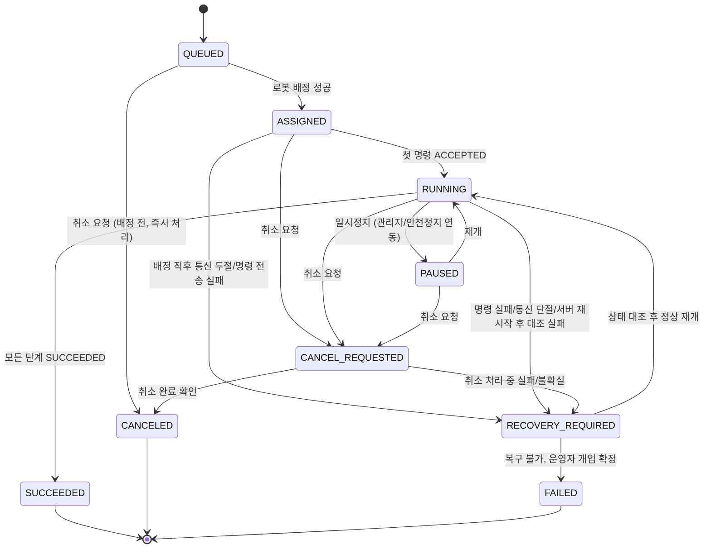

| From | To | Trigger | Guard / 비고 |
|---|---|---|---|
| QUEUED | ASSIGNED | 배정기가 로봇 선택 성공 | 동시 배정 방지 트랜잭션 필요 (ERD §9) |
| QUEUED | CANCELED | 작업자/관리자 취소 | 물리 동작 없음 → 중간 상태 없이 즉시 종료 |
| ASSIGNED | RUNNING | 첫 `robot_commands`가 ACCEPTED | |
| ASSIGNED | CANCEL_REQUESTED | 취소 요청 | 아직 적재 전이므로 배정 해제만으로 취소 가능한 경우가 많음 |
| ASSIGNED | RECOVERY_REQUIRED | 배정 직후 명령 전송/응답 실패 | |
| RUNNING | SUCCEEDED | 마지막 단계 SUCCEEDED | |
| RUNNING | PAUSED | 관리자 일시정지, 로봇 PROTECTIVE_STOP 등 | 화면 정지 요청과 로봇 실제 안전 정지는 별도 축(§4 참고) — task.PAUSED는 업무 흐름 정지일 뿐, 로봇 안전 상태와 동일시하지 않는다 |
| RUNNING | CANCEL_REQUESTED | 취소 요청 | 8단계에서 정책 확정 — 아래 참고 |
| RUNNING | RECOVERY_REQUIRED | 명령 실패, 통신 단절, 서버 재시작 후 로봇 실제 상태와 불일치 | 재시도 전 반드시 로봇/설비 실제 상태 확인 (DESIGN.md §9) |
| PAUSED | RUNNING | 재개 | |
| PAUSED | CANCEL_REQUESTED | 취소 요청 | |
| CANCEL_REQUESTED | CANCELED | 적재 전이거나 하역까지 끝난 상태 | 8단계: 동기 시뮬레이터라 "취소 명령을 보내고 응답을 기다리는" 절차가 없어 즉시 확정한다 |
| CANCEL_REQUESTED | RECOVERY_REQUIRED | 적재 중(물품이 로봇에 있음) | 8단계: 물품을 실은 채 임의로 취소를 확정하지 않고 운영자가 `recover`(RESUME/FAIL)로 결정하게 한다 — 취소 명령 응답 없음/실패도 같은 경로 |
| RECOVERY_REQUIRED | RUNNING | 상태 대조 결과 정상, 남은 단계부터 재개 | |
| RECOVERY_REQUIRED | FAILED | 자동 복구 불가, 운영자가 최종 실패 처리 | 감사 로그 필수 |

**종료 상태**: `SUCCEEDED`, `CANCELED`, `FAILED` — 이후 전이 없음.

---

## 2. 작업 단계 (Task Step)

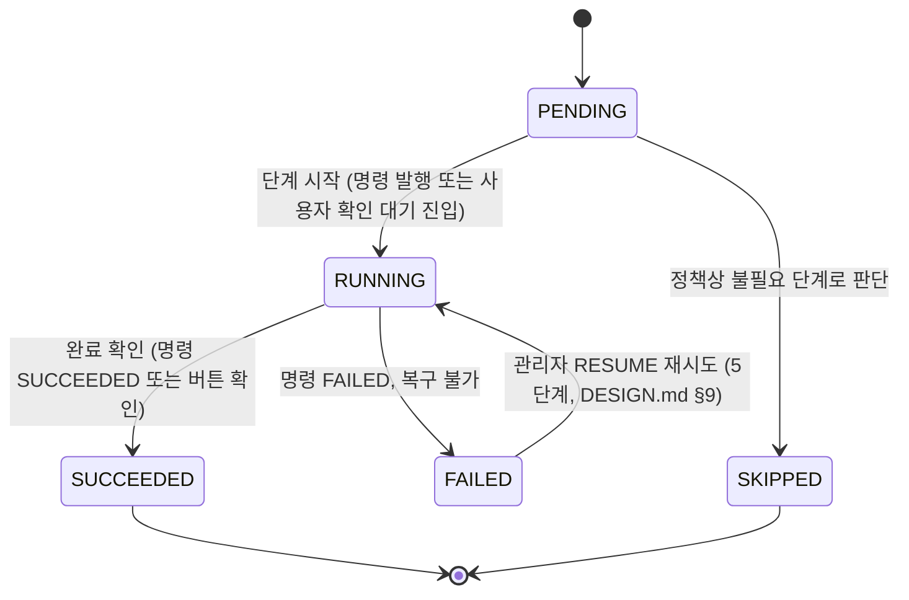

| From | To | Trigger | Guard / 비고 |
|---|---|---|---|
| FAILED | RUNNING | 관리자가 `POST /api/admin/tasks/{taskId}/recover`에 `RESUME` 요청 | 상위 Task가 `RECOVERY_REQUIRED`일 때만 가능. 같은 단계에 새 `robot_commands`를 발행해 재시도한다 (§3의 "활성 명령 최대 1개" 규칙은 이전 명령이 `FAILED`로 종료돼 있어 위반하지 않음) |

- 단계는 `task_steps.step_no` 순서대로 진행하되, 서버가 동시에 여러 단계를 `RUNNING`으로 열지 않는다 (한 번에 하나의 활성 단계).
- 단계 상태 변화는 상위 Task 상태에 다음과 같이 반영된다.
  - 첫 단계가 `RUNNING` → Task `RUNNING`
  - 마지막 단계가 `SUCCEEDED` → Task `SUCCEEDED`
  - 임의 단계가 `FAILED` → Task `RECOVERY_REQUIRED` (즉시 `FAILED` 아님 — 운영자/복구 로직이 먼저 판단)
- `SKIPPED`는 현재 설계 범위에서 사용처가 확정되지 않음 — 조건부 단계(예: 목적지가 충전소라 하역 단계가 없는 경우) 도입 시 활용, 아니라면 초기 구현에서 제외 가능.

---

## 3. 로봇 명령 (Robot Command)

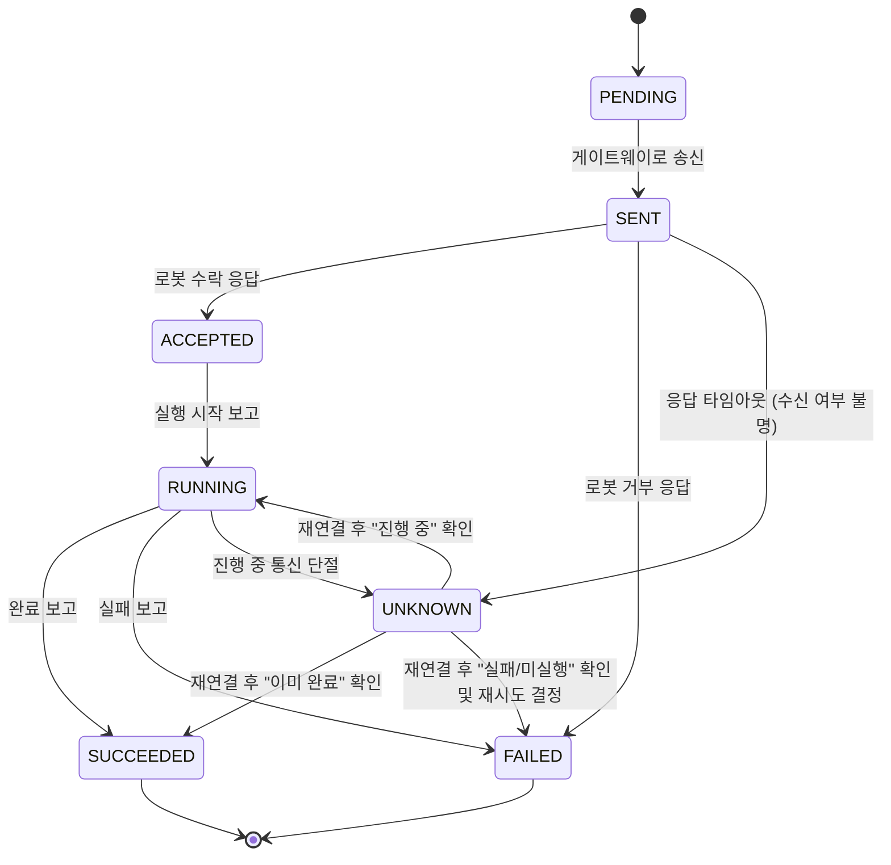

- `UNKNOWN`은 DESIGN.md §6의 "응답이 없어서 실제 실행 여부를 모르는 경우"에 대응하는 상태다. **`UNKNOWN`을 임의로 `FAILED`로 간주해 재전송하지 않는다** — 반드시 로봇/게이트웨이에 실제 상태를 재조회한 뒤에만 다음 상태로 전이한다.
- `command_events`에 모든 전이가 기록되며, `occurred_at`(로봇 보고 시각)과 `received_at`(서버 수신 시각)을 분리해 지연·유실을 감지한다.
- 하나의 `task_step`에 대해 활성(`PENDING`~`RUNNING`) 명령은 최대 1개만 존재해야 한다 (중복 명령 방지, DESIGN.md §9).

---

## 4. 로봇 상태 (다축, 독립 상태)

로봇 상태는 단일 FSM이 아니라 **서로 독립적인 축**이다 (`robot_current_states`/`robot_state_snapshots` 컬럼과 대응). 각 축은 별도로 전이되며 동시에 여러 값을 가진다 (예: `연결=ONLINE`, `동작=MOVING`, `안전=NORMAL`가 동시에 성립).

### 4.1 연결 (connection_state)

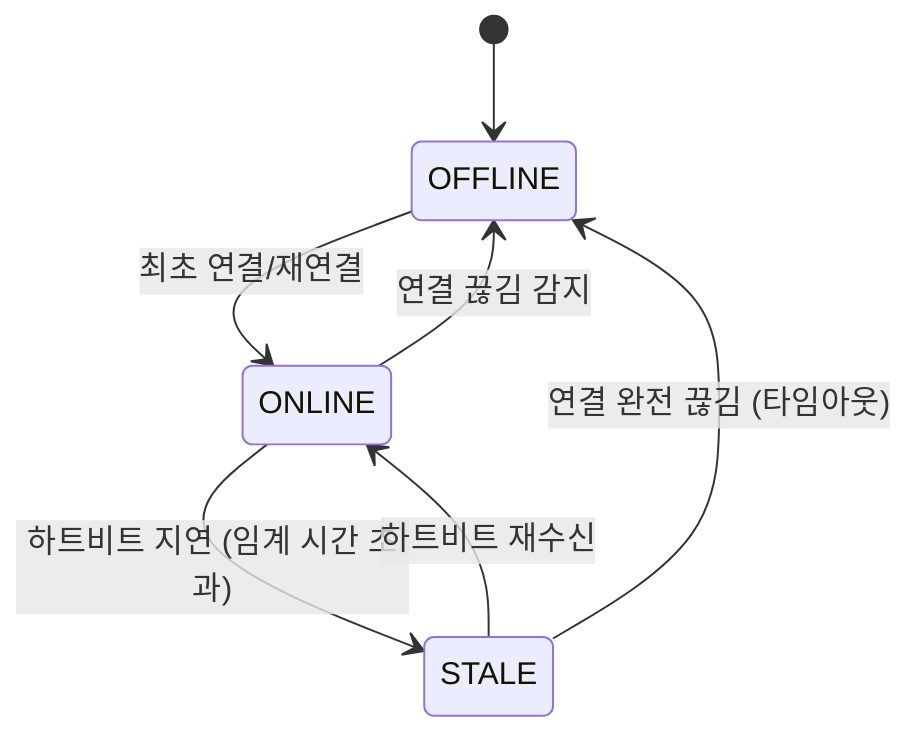

**29단계 구현 — 하트비트 기반 연결 감시**: 18단계까지는 연결 축이 명령을 보낼 때만 바뀌어, 대기 중인 로봇이 꺼져도 ONLINE으로 남았다. 이제 서버가 `received_at`(마지막 수신 시각)을 보고 판정한다(`RobotConnectionService`).

| 전이 | 트리거 | 부수 효과 |
|---|---|---|
| `ONLINE → OFFLINE` | 운영 중(`IN_SERVICE`) 로봇의 마지막 수신이 `app.robot.heartbeat-timeout-seconds`(기본 30초)보다 오래됨. 감시 주기 기본 5초 | `robot_state_snapshots` 기록, `ROBOT_COMM_LOST` 알람 발생 |
| `OFFLINE → ONLINE` | MQTT: 로봇의 state 메시지 수신(주문과 무관한 메시지 포함). 시뮬레이터: 다음 시뮬레이터 하트비트(통신 두절 장애가 주입된 로봇은 제외) 또는 다음 정상 명령 | 스냅샷 기록, `ROBOT_COMM_LOST` 자동 해소 |

- **수신 시각을 누가 갱신하나**: MQTT 게이트웨이는 로봇이 보내는 모든 state 메시지를 텔레메트리로 기록한다. 시뮬레이터 모드에는 실제 네트워크가 없어, 서버가 운영 중 로봇의 하트비트를 주기적으로 대신 친다(시뮬레이터 하트비트).
  - ONLINE 로봇은 수신 시각만 갱신한다.
  - OFFLINE 로봇은 ONLINE으로 복구한다. 서버가 타임아웃보다 오래 꺼져 있다 다시 뜨면, 첫 감시가 첫 하트비트보다 먼저 돌아 로봇을 OFFLINE으로 바꿀 수 있기 때문이다(로컬 실행 중 발견). 시뮬레이터 로봇은 스스로 텔레메트리를 보내지 않으므로, 복구하지 않으면 영영 배정 대상에서 빠진다.
  - 단, `COMMUNICATION_LOSS` 장애가 주입된 로봇은 되살리지 않는다. 기존처럼 다음 정상 명령에서만 복구된다. 이 목록은 시뮬레이터 메모리에만 있어 재시작 시 초기화된다.
- **감시 대상**: `IN_SERVICE` 로봇만 본다. 정비·등록 상태 로봇은 하트비트가 없어도 알람을 올리지 않는다.
- **`STALE`은 여전히 미사용**이다. 지연과 끊김을 나눌 두 번째 임계값이 정해지지 않아, 타임아웃이 지나면 바로 `OFFLINE`으로 본다.
- 감시와 하트비트는 `app.robot.connection-monitor.enabled`(기본 `false`, local 프로필에서만 `true`)로 켠다.
- **32단계 — 기동 유예**: 서버가 뜬 뒤 하트비트 타임아웃(기본 30초) 동안은 `ONLINE → OFFLINE` 판정을 하지 않는다. 서버가 꺼져 있던 동안은 누구도 수신 시각을 갱신하지 못해, 재기동 직후 첫 판정이 모든 로봇을 OFFLINE·알람으로 바꿨다가 곧바로 해소하는 헛알람이 재시작할 때마다 생겼다. 시뮬레이터 하트비트는 기동 직후에도 바로 친다.
- 상태 행은 조건부 bulk update로 갱신한다. 명령 처리가 같은 행을 동시에 갱신 중일 때 오래된 행 전체를 덮어쓰지 않기 위해서다.

### 4.2 운전 모드 (operation_mode)

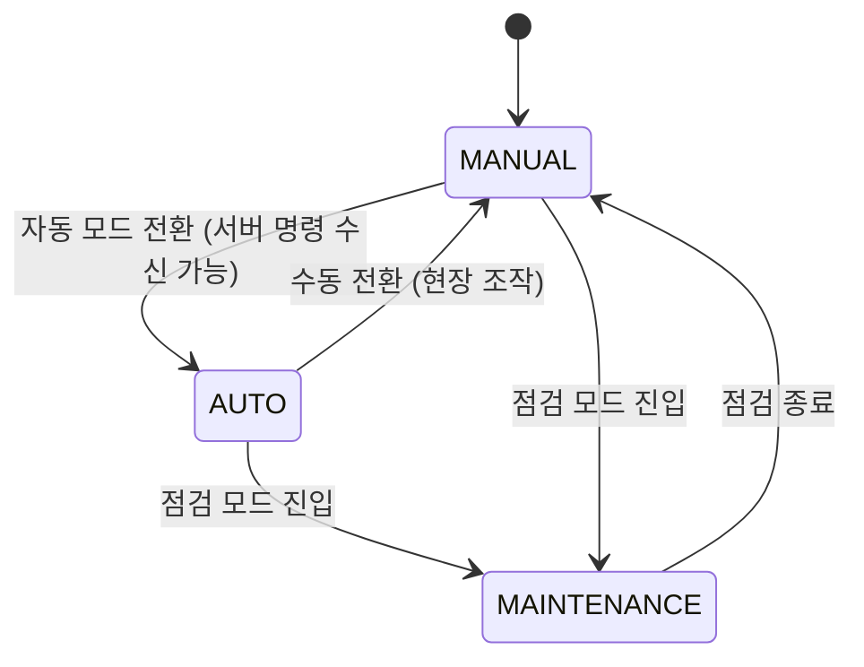

- `AUTO`가 아니면 서버는 신규 명령을 보내지 않는다 (배정 대상에서 제외).

### 4.3 동작 (motion_state)

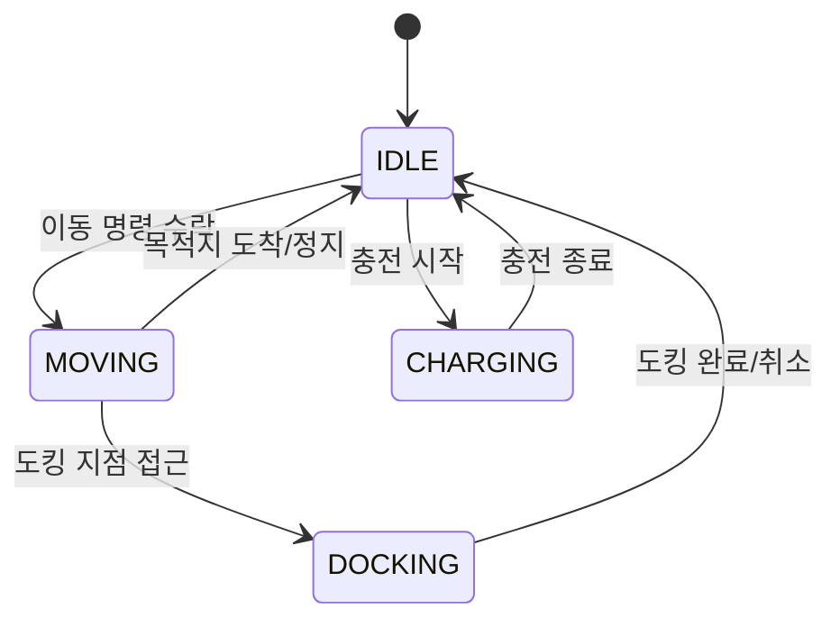

### 4.4 안전 (safety_state)

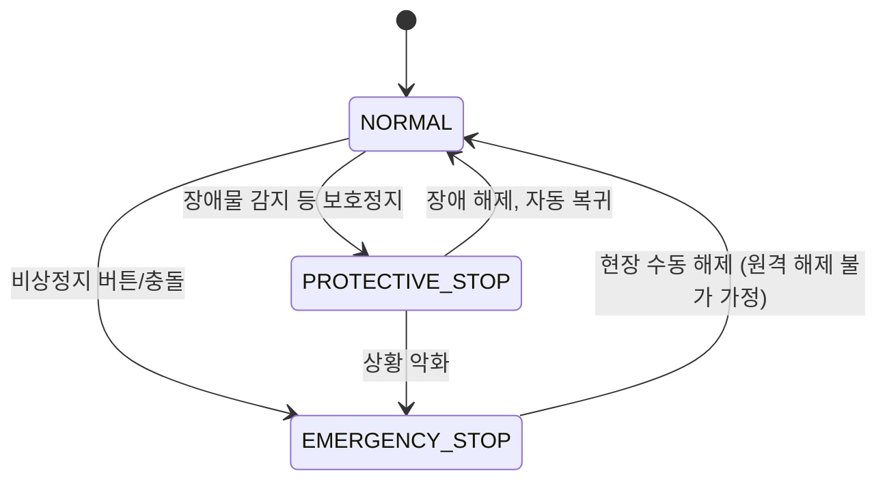

- **화면의 "정지 요청" 성공과 이 `safety_state`는 별개다.** 서버는 정지 명령을 SENT/ACCEPTED까지만 확인할 수 있고, 실제 `EMERGENCY_STOP`/`PROTECTIVE_STOP` 여부는 로봇이 보고하는 이 값으로만 판단한다 (DESIGN.md §3).

### 4.5 적재 (load_state)

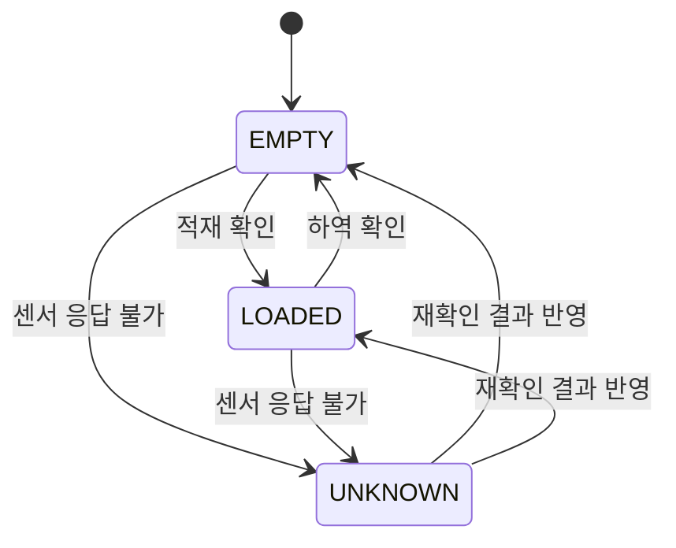

### 4.6 위치 추정 (localization_state)

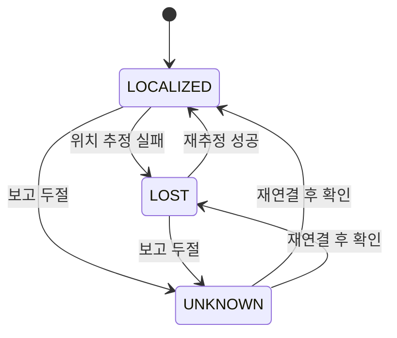

- `LOST` 또는 `UNKNOWN`인 로봇은 신규 이동 명령 배정에서 제외한다.

---

## 5. 충전 세션 (Charging Session)

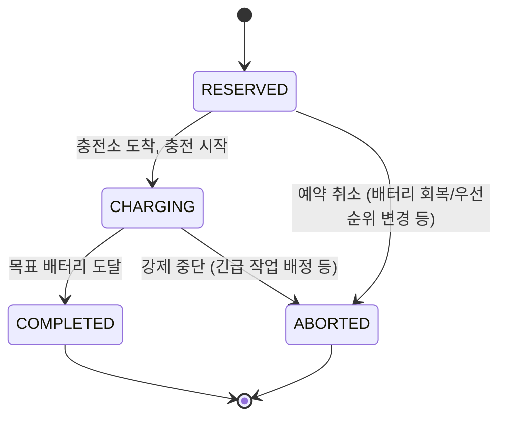

**7단계 구현**: 시뮬레이터가 충전을 즉시 처리해 `RESERVED`는 순간적으로만 존재한다. `DOCK_AND_CHARGE` 단계가 `RobotCommandType.START_CHARGE` 명령을 발행하면 `RESERVED→CHARGING`, 명령이 성공하면 배터리를 로봇 설정의 `chargingTargetPct`(없으면 100)까지 채우고 `CHARGING→COMPLETED`, 실패하면 `ABORTED`로 전이한다.

---

## 6. 자원 예약 (Resource Reservation — 통로/구역/정류지점)

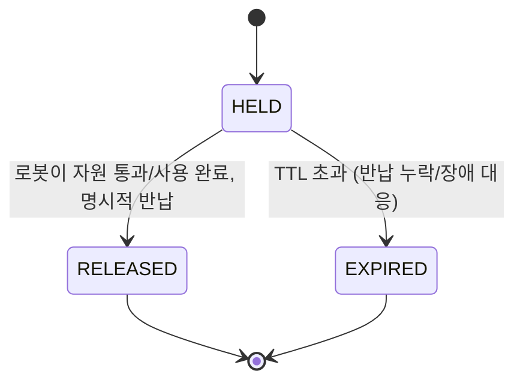

**7단계 구현**: `resource_type`은 `STATION`만 실제로 사용한다 — `EDGE`/`ZONE` 기반 예약은 로봇의 현재 위치(노드) 추적이 아직 없어 계산할 수 없다 (`MOVE_TO_ORIGIN`의 출발 노드를 모름). MOVE 단계를 시작할 때 목적지 station을 예약하고, 그 station에서의 다음 확인 단계(`CONFIRM_LOAD`/`CONFIRM_UNLOAD`/`DOCK_AND_CHARGE`)가 성공할 때 해제한다 — "이동 중"이 아니라 "그 station을 실제로 점유하는 구간"을 예약 구간으로 본다. 용량(`stations.max_concurrent_robots`, `null`이면 무제한) 초과 시 예약 자체를 거부(409)한다 — 모든 처리가 한 트랜잭션 안에서 즉시 성공하거나 즉시 롤백되므로 로봇이 자원을 쥔 채 대기하며 순환 대기(교착)를 만드는 코드 경로가 없다. `EXPIRED`/`expires_at`은 스키마에만 있고 아직 채우지 않는다 — TTL은 비동기/실제 로봇 통신이 도입된 뒤 의미가 생긴다.

- `EXPIRED`는 통신 단절 등으로 반납되지 않은 예약이 교통을 영구 차단하지 않도록 하는 안전장치다. TTL 값과 만료 시 실제 로봇 위치 재확인 절차는 7단계(다중 로봇 운영) 구현 시 확정한다.

---

## 7. 알람 (Alarm)

**14단계 구현**: `alarms`/`alarm_events`(`ERD.md` §4.10, `API.md` §3 참고). 다이어그램과 다른 점 두 가지 — ① `OPEN → RESOLVED`는 "자동 해소"뿐 아니라 관리자가 확인 단계를 건너뛰고 바로 `resolve`를 호출하는 경우에도 일어난다(단순화). ② `RESOLVED → OPEN`(재발생)은 미구현이다 — 같은 (alarm_type, source_type, source_id) 조합이 다시 발생하면 기존 row를 재사용하지 않고 새 알람 row를 만든다. `alarm_events.event_type`도 `RAISED`/`ACKNOWLEDGED`/`RESOLVED` 3종만 실제로 쓰고 `REOPENED`는 미사용이다. 8단계(운영 장애 복구)에서 이미 확정된 개입 흐름(`Task.status = RECOVERY_REQUIRED` + `recover` API, §1 참고)은 그대로 유지되며, 이 알람 FSM으로 대체되지 않는다 — `TASK_FAILED` 알람은 `recover`가 작업을 최종 실패 처리할 때 **함께** 발생하는 별도 신호다.

**27단계 — `TASK_RECOVERY_REQUIRED`**: 작업이 §1의 `RECOVERY_REQUIRED`로 들어가는 세 경로(로봇 명령 `FAILED`/`UNKNOWN`, 적재 중 취소, 작업자 작업 불가 보고)가 모두 `TaskService.markRecoveryRequired()`를 거치며 이 알람(`WARNING`, 대상 `TASK`)을 함께 올린다. 메시지에 원인이 들어간다(작업 불가 보고는 사유 포함). 이전에는 작업 상태만 바뀌고 관리자에게 알릴 신호가 없었다. `recover`의 `RESUME`/`FAIL` 시 자동 해소된다. `RESUME`은 명령을 재발행하기 **전에** 해소하므로, 재발행한 명령이 또 실패하면 새 알람이 다시 뜬다. `FAIL`이면 이 알람은 해소되고 `TASK_FAILED`가 새로 남는다.

| 알람 종류 | 발생 | 해소 | 심각도 |
|---|---|---|---|
| `ROBOT_COMM_LOST` | 로봇 연결 `OFFLINE` 전이 | 연결 복구 시 자동 | WARNING |
| `LOCALIZATION_LOST` | 위치 추정 `LOST` 전이 | 복구 시 자동 | WARNING |
| `LOAD_EXCEPTION` | 적재 센서 `UNKNOWN` 전이 | 복구 시 자동 | WARNING |
| `TASK_RECOVERY_REQUIRED` | 작업 `RECOVERY_REQUIRED` 전이 (27단계) | `recover` RESUME/FAIL 시 자동 | WARNING |
| `TASK_FAILED` | `recover` FAIL로 작업 최종 실패 | 관리자가 직접 확인·해제 | CRITICAL |

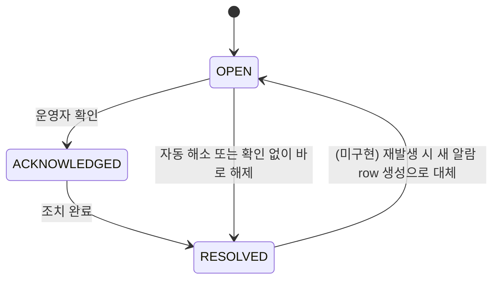

---

## 8. 작업 배정 (Task Assignment)

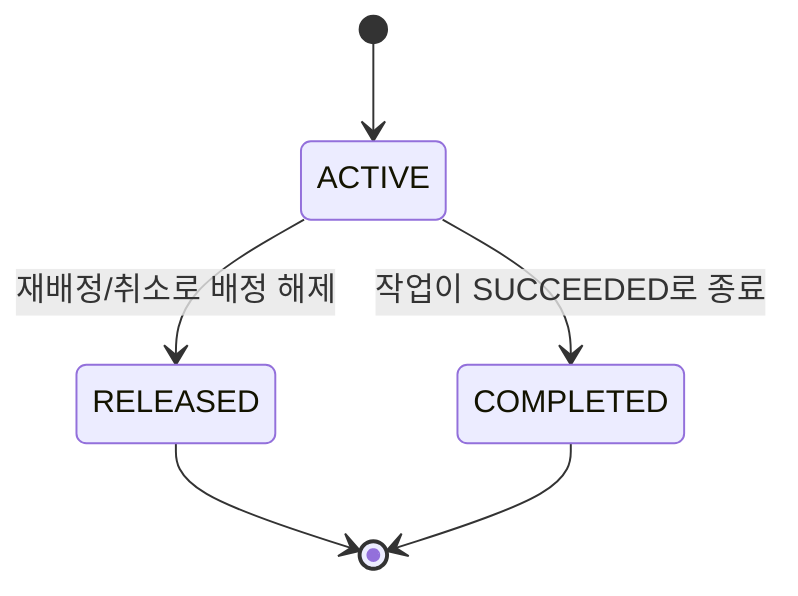

- 하나의 Task에 대해 동시에 `ACTIVE`인 배정은 **최대 1개**여야 하며, `tasks.current_assignment_id`가 그 row를 가리킨다.
- 재배정이 일어나면 기존 row는 `RELEASED`로 남기고 새 row를 `ACTIVE`로 생성한다 (덮어쓰지 않음 — 배정 이력 보존).

---

## 9. 지도 버전 (Map Version)

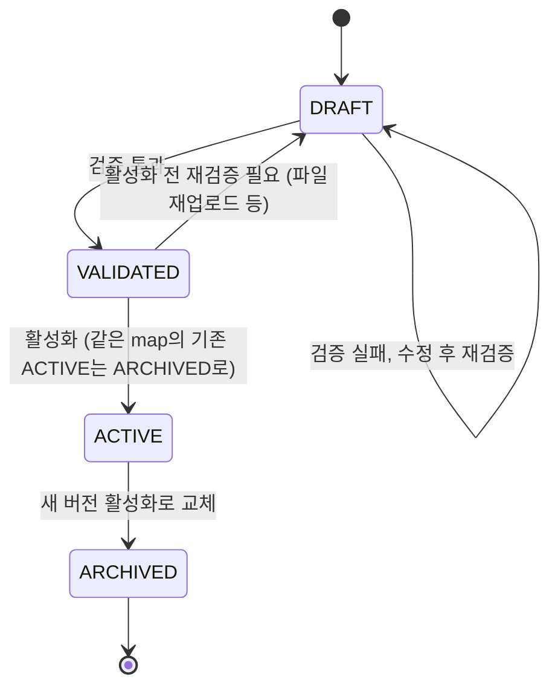

- 하나의 `maps.id`에 대해 `ACTIVE` 버전은 항상 최대 1개.
- `VALIDATED`가 아닌 버전은 `activate` 호출 시 거부한다 (API.md §2.3).

---

## 10. 물품 (Load) — **미구현**

`loads` 테이블과 이 상태 전이는 구현되지 않았다(`ERD.md` §4.8 참고). 현재는 물품 단위 추적 없이 `task_steps`(`CONFIRM_LOAD`/`CONFIRM_UNLOAD`)만으로 적재·하역을 확인하며, `EXCEPTION`에 해당하는 `report-out-of-stock`도 8단계에서 정책 미정으로 보류됐다(`API.md` §4).

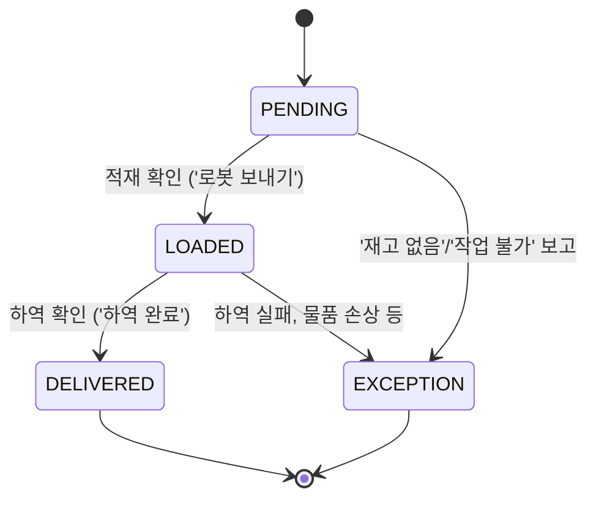

- `loads.status`와 로봇 `load_state`(§4.5)는 별개 축이다 — 연결 규칙은 ERD.md §4.8 참고.
- `EXCEPTION` 이후 처리(재시도/작업 취소로 이어지는지)는 DESIGN.md §5에서 이미 미정으로 표시된 항목과 동일한 미확정 지점이다.

---

## 11. 로봇 생명주기 (robots.lifecycle_status)

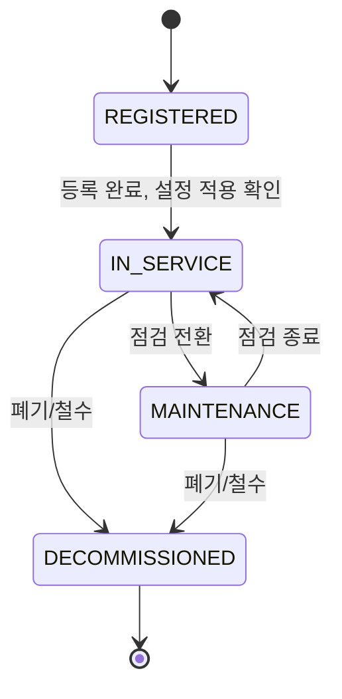

- 이 상태는 관리자가 직접 설정하는 값이며, §4.2의 `operation_mode`(로봇이 실시간 보고하는 값)와는 **독립적**이다. 동기화 규칙은 ERD.md §4.4 참고.

---

## 12. 열린 질문 (구현 전 확정 필요)

- `TaskStep.SKIPPED` 사용 여부 — 조건부 단계 도입 전까지는 스키마에만 존재하고 로직에서 미사용으로 둘지 결정 필요.
- `safety_state.EMERGENCY_STOP` 해제를 원격으로 허용할지(현재는 현장 수동 해제만 가정) — 로봇 제조사 사양 확인 후 결정.
- 자원 예약 TTL 값과 만료 처리 시 로봇 위치 재확인 로직의 구체적 절차.
- `lifecycle_status`와 `operation_mode`가 어긋난 상태(예: `MAINTENANCE`인데 로봇은 `AUTO` 보고)가 일정 시간 지속되면 알람을 띄울지 여부.
- 지도 버전 검증 실패 사유를 저장할 컬럼(`map_versions.validation_errors` 등)이 필요한지 — 현재 ERD엔 없음, 검증 규칙 구체화 시 함께 결정.
- 충전 작업이 `tasks`/`task_steps`를 재사용한다면 위 Task/Task Step 다이어그램이 그대로 적용되는지, 충전 전용 규칙(예: 배터리 목표 도달을 별도 완료 조건으로 볼지)이 추가로 필요한지.
